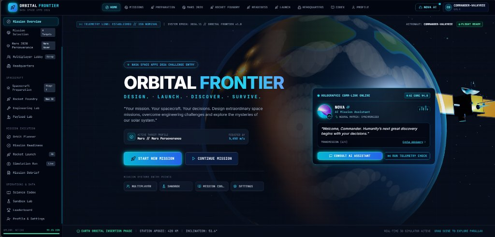
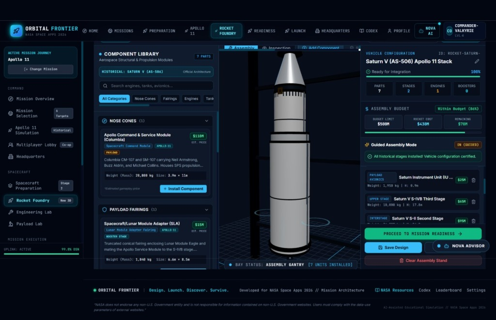
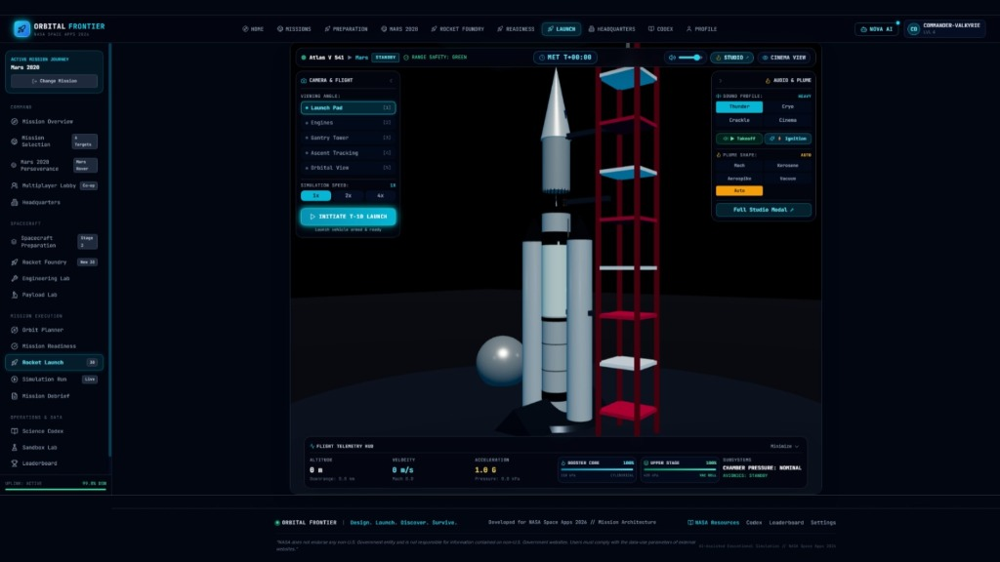
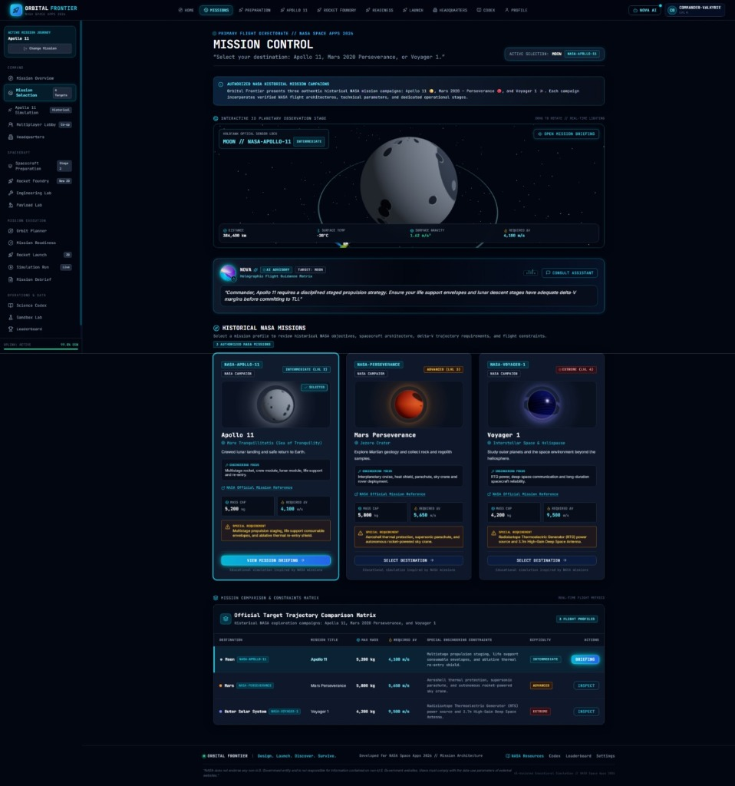
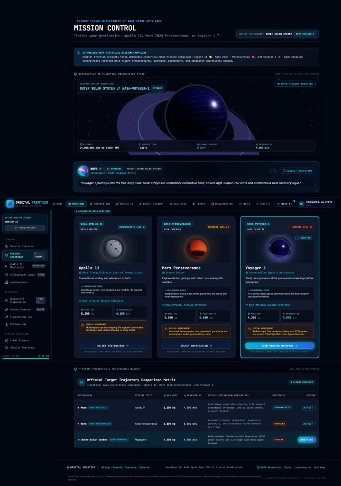

# 🌌 Orbital Frontier — NASA Space Apps 2026
### *Design. Launch. Discover. Survive.*

[](https://www.spaceappschallenge.org/)
[](https://opensource.org/licenses/MIT)
[](https://threejs.org/)
[](https://react.dev/)
[](https://tailwindcss.com/)

**Orbital Frontier** is an immersive, high-fidelity 3D space exploration and spacecraft mission simulator developed by team **MissionForge** for the **NASA Space Apps Challenge 2026**.

The platform bridges real-world aerospace physics, orbital mechanics, and interactive WebGL graphics. It empowers players, students, and engineers to custom-build multi-stage rockets, calculate trajectories, launch into orbit, and relive historic NASA deep-space missions.

---

<div align="center">
  
</div>

---

## 🌟 Key Features

### 🛠️ 1. Interactive 3D Rocket Foundry & Engineering Lab
- **Modular Component Library:** Configure multi-stage propulsion modules, aerodynamic fairings, scientific sensor packages, avionics, and payload adapters (featuring authentic historical architectures like the **Saturn V AS-506**).
- **Guided Assembly & Diagnostics:** Real-time diagnostics for wet/dry mass budgets, stage sequencing, center of gravity, and component costs.
- **NOVA AI Co-Pilot:** Real-time conversational flight and advisory assistance to optimize staging and system readiness.

<div align="center">
  
</div>

---

### 🚀 2. 3D Launch Pad & Live Telemetry Studio
- **Dynamic Launch Operations:** High-resolution 3D launch pad visualization with gantry towers, multi-camera angles (Launch Pad, Engines, Gantry Tower, Ascent Tracking, Orbital View).
- **Acoustic & Plume Simulation:** Configurable sound engines (Thunder, Cryo, Crackle, Cinema) and aerodynamic plume geometries (Aerospike, Vacuum, Kerosene).
- **Real-Time Telemetry:** Flight metrics tracking altitude, velocity ($\text{m/s}$, Mach number), G-force acceleration, chamber pressure, and booster core burn rates.

<div align="center">
  
</div>

---

### 🛰️ 3. Iconic NASA Historical Mission Campaigns
Step into mission control with full interactive 3D planetary observatory stages, target comparison matrices, and custom trajectory profiles:

- 🌕 **Apollo 11 (Mare Tranquillitatis):** Multi-stage propulsion staging, Saturn V launch stack, Command/Service Module docking, and lunar descent execution.
- 🔴 **Mars Perseverance (Jezero Crater):** Interplanetary cruise, aeroshell thermal protection, supersonic parachute deployment, and sky crane rover touchdown.
- 🌌 **Voyager 1 (Interstellar Space & Heliopause):** Deep space trajectory navigation beyond $24,000,000,000\text{ km}$, autonomous fault recovery logic, and RTG power management.

<div align="center">
  <table>
    <tr>
      <td align="center"><b>Apollo 11 — Lunar Landing Mission Control</b></td>
      <td align="center"><b>Voyager 1 — Interstellar Trajectory Mission Control</b></td>
    </tr>
    <tr>
      <td></td>
      <td></td>
    </tr>
  </table>
</div>

---

### 📚 4. Science Codex & Educational Framework
- **Accessible Aerospace Physics:** Interactive explanations of the Tsiolkovsky rocket equation, orbital mechanics, Hohmann transfer windows, and atmospheric drag.
- **Flight Debriefs & Leaderboard:** Detailed mission performance scoring, orbital accuracy evaluations, and collaborative mission modes.

---

## 🛠️ Tech Stack

| Domain | Technologies |
| :--- | :--- |
| **Frontend Framework** | [React 18](https://react.dev/), [Vite](https://vitejs.dev/) |
| **3D Graphics & Rendering** | [Three.js](https://threejs.org/), [@react-three/fiber](https://docs.pmnd.rs/react-three-fiber), [@react-three/drei](https://github.com/pmndrs/drei) |
| **UI & Design System** | [Tailwind CSS](https://tailwindcss.com/), [Lucide React Icons](https://lucide.dev/) |
| **Simulation & Physics** | Keplerian orbital elements, dynamic trajectory propagation, gravitational body models |
| **AI Integration** | NOVA AI Mission Co-pilot & Advisory Matrix |

---

## 🚀 Getting Started

### Prerequisites
Make sure you have **Node.js** (v18+) or **Python** (v3+) installed.

### 1. Clone the Repository
```bash
git clone https://github.com/mobeenj-12/Missoneers.git
cd Missoneers
```

### 2. Run the Application

#### Option A: Using `npx serve` (Recommended)
```bash
npx serve
```
Open your browser and visit: **`http://localhost:3000`**

#### Option B: Using Python
```bash
python -m http.server 5000
```
Open your browser and visit: **`http://localhost:5000`**

---

## 👥 The Team — MissionForge
Developed with ❤️ for the **NASA Space Apps Challenge 2026**.

- **Team Name:** MissionForge
- **Project Name:** Orbital Frontier

---

## 📄 License
This project is licensed under the MIT License - see the [LICENSE](LICENSE) file for details.
